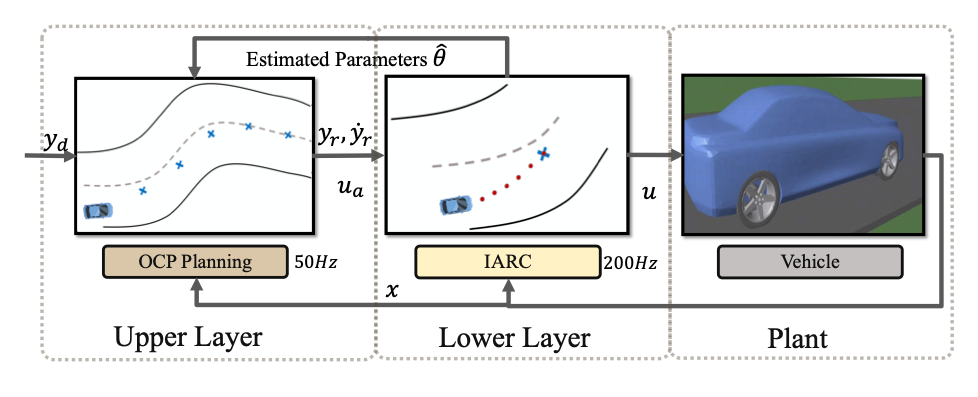
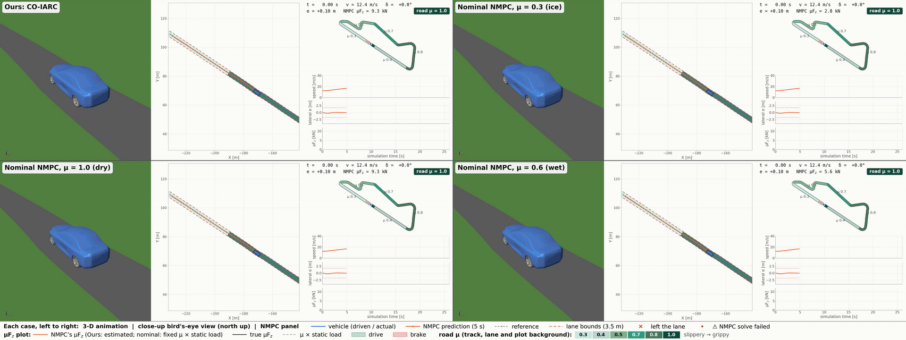
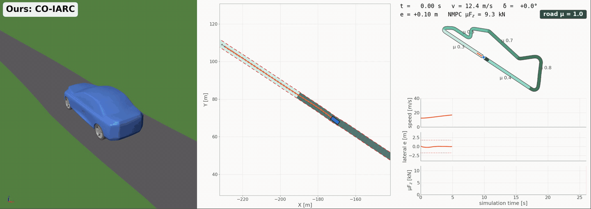
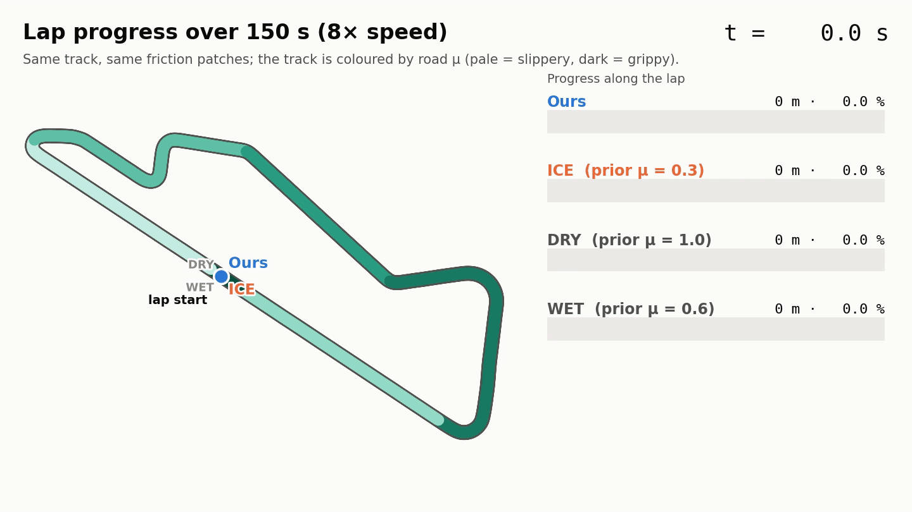

<h1 align="center">Online Constraint Optimization-Based Indirect-Adaptive Robust Control for Autonomous Vehicles with Unknown Friction</h1>

<p align="center">
  <b>Yupeng Zhou</b>, <b>I-Chia Chang</b>, <b>Ziran Wang</b>, <b>Bin Yao</b><br>
  College of Engineering, Purdue University
</p>

<p align="center">
  <a href="#citation"></a>
  <a href="#demo"></a>
</p>

## Abstract

Friction uncertainty is a significant challenge for autonomous vehicle control, undermining feasibility and performance. This paper proposes a novel two-layer control framework to achieve vehicle motion control under large friction uncertainty by combining optimization-based planning with indirect adaptive robust control (IARC). The upper layer solves a constrained optimal control problem to generate a feasible trajectory that satisfies all the constraints in a time-optimal manner along the desired path. The lower layer, IARC, adapts the unknown parameters related to friction uncertainty and combines model compensation with robust feedback to ensure transient and steady-state tracking performance. An estimation monitor is designed to prevent poor learning when data indicate a model mismatch, while a smooth parameter reset reduces the estimated tire capacity and limits abrupt tightening of constraints. The updated parameters are fed back into the model and constraints in the planner, enabling trajectory replanning as friction conditions change. Simulation results indicate that the proposed method achieves accurate tracking of the desired trajectory and online friction adaptation under large friction uncertainty while ensuring time-optimal vehicle motion.

## Method

<p align="center">
  
</p>
<p align="center"><i>Fig. 1. Two-layer control framework.</i></p>

- **Upper layer: OCP planning (50 Hz).** It solves a constrained optimal control problem over a 5.04 s horizon (40 intervals). The result is a time-optimal trajectory that stays feasible for the current friction estimate.
- **Lower layer: IARC (200 Hz).** It adapts the friction-related parameters online and combines model compensation with robust feedback to track that trajectory.
- **Parameter feedback.** The estimated parameters θ̂ update the planner's model and constraints, so the trajectory is replanned as friction changes. An estimation monitor blocks learning on data that indicate a model mismatch, and a smooth parameter reset limits abrupt tightening of the constraints.

## Results

The evaluation uses a high-fidelity Simscape Multibody Vehicle Simulation with a real-world Monteblanco track. The vehicle starts on a dry road patch (μ = 1.0) at the centerline at 12.44 m/s, followed by friction patches with μ = 0.3, 0.5, 0.7, 0.8, and 0.4 to simulate different friction conditions.

The four methods compared:

- **Ours:** the proposed framework, starting from the friction estimate μ̂(0) = 1.0.
- **DRY, WET, ICE:** nominal NMPC without adaptation. Each keeps a fixed friction prior of μ = 1.0, 0.6, and 0.3, respectively.

<p align="center"><b>Table 1.</b> Performance on test track with different friction patches.</p>

| Method | Time / lap (s) | e<sub>lat</sub> RMSE (m) | e<sub>lat</sub> max (m) | e<sub>speed</sub> RMSE (mm/s) | e<sub>speed</sub> max (mm/s) | e<sub>yaw</sub> RMSE (deg) | e<sub>yaw</sub> max (deg) |
|:---:|:---:|:---:|:---:|:---:|:---:|:---:|:---:|
| DRY | crashed (s = 200 m) | ≥ 6 | ≥ 6 | 3.103 | 8.011 | 3.521 | 22.747 |
| WET | crashed (s = 262 m) | ≥ 6 | ≥ 6 | 2.161 | 11.721 | 6.254 | 21.021 |
| ICE | 202.7 | 0.213 | 0.779 | 0.203 | 0.735 | 1.418 | 5.467 |
| **Ours** | **153.2** | **0.208** | **0.772** | **0.168** | **0.688** | **1.224** | **5.389** |

- **DRY and WET** overestimate the grip in the first μ = 0.3 patch and crash.
- **ICE** stays conservative after the grip increases. It takes 202.7 s for the lap, 32% longer than ours.
- **Ours** completes the lap in 153.2 s with the smallest tracking errors.

## Demo

All four methods run on the same simulation clock.

- **Simulation GIFs (blocks 1 and 2):**
  - **Rows:** Ours and ICE on top, DRY and WET below.
  - **Tiles per method, left to right:** the 3-D Simscape Multibody animation, a close-up bird's-eye view, and the NMPC panel. The NMPC panel shows the map, speed, lateral error, and the rear-tire capacity μF<sub>z</sub> used by the NMPC, compared with the true values.
  - ** Colors:** blue is the vehicle, orange is the NMPC prediction, and teal shades show the road friction (pale = slippery, dark = grippy).
  - **Legend:** a strip along the bottom explains every line and color.
- **Full video:** [media/demo_three_quarter.mp4](media/demo_three_quarter.mp4) (5760 × 2160, 30 fps, 150 s, 76 MB).

### 1. An overestimated friction prior leads to loss of stability (first 20 s)

<p align="center">
  
</p>
<p align="center"><i>DRY (μ = 1.0) and WET (μ = 0.6) overestimate the tire capacity on the first μ = 0.3 patch. They lose stability and leave the lane, while Ours and ICE stay in it. Click the image to view it full size.</i></p>

### 2. Ours: online friction adaptation over the full lap (6× speed)

<p align="center">
  
</p>
<p align="center"><i>The estimated tire capacity (orange, bottom plot) follows the true capacity (black) through every friction patch. The planner replans the trajectory with the updated estimate.</i></p>

### 3. A conservative static prior is not time-optimal (8× speed)

<p align="center">
  
</p>
<p align="center"><i>Lap progress of all four methods on one track map. ICE (μ = 0.3) stays in the lane but remains conservative after the grip increases. At t = 150 s, it has covered 71% of the lap, while Ours has covered 99.9%. In the paper's runs (Table 1), Ours completes the lap in 153.2 s, and ICE needs 202.7 s, 32 % longer.</i></p>

> The demo runs were re-simulated for visualization. They use the same track, controllers, and friction patches as the paper. The dry launch section also covers the 50 m before the starting point, so values in the video can differ slightly from Table 1.

## Related repositories

- [Vehicle Dynamics 14DOF Simscape Multibody](https://github.com/mathworks/Vehicle-Dynamics-14DOF-Simscape-Multibody) (MathWorks): the 14-DOF vehicle model used in the simulations.
- [TUM-CONTROL](https://github.com/bzarr/TUM-CONTROL): the source of the Monteblanco track data.

## Citation

The paper will be on arXiv soon; the link and BibTeX will be updated then.

```bibtex
@article{zhou2026coiarc,
  title   = {Online Constraint Optimization-Based Indirect-Adaptive Robust Control for Autonomous Vehicles with Unknown Friction},
  author  = {Zhou, Yupeng and Chang, I-Chia and Wang, Ziran and Yao, Bin},
  journal = {arXiv preprint arXiv:XXXX.XXXXX},
  year    = {2026}
}
```
